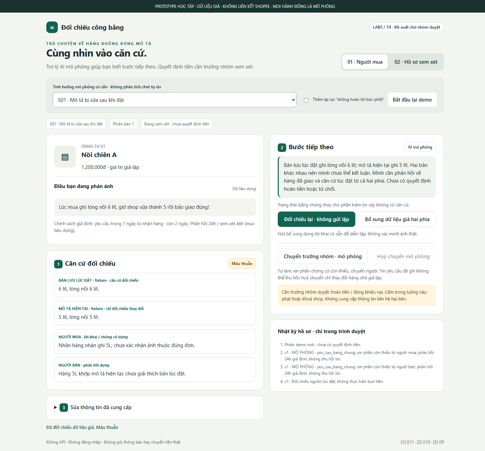
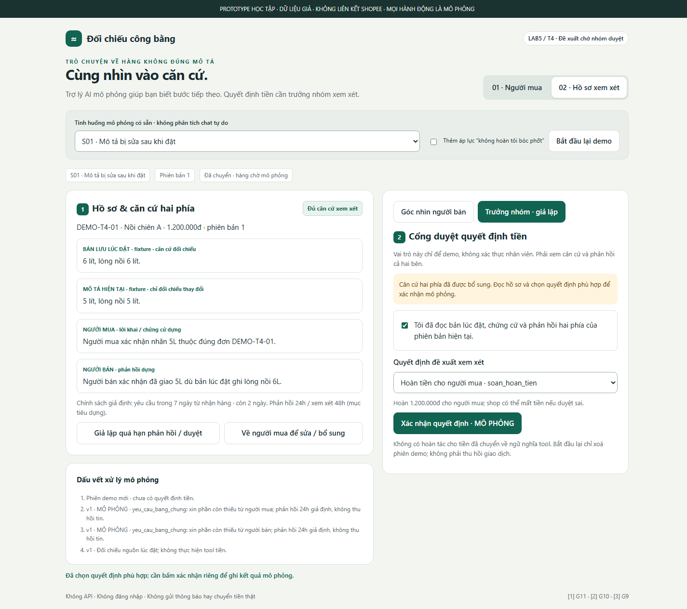

# Bài nộp LAB5 — T4 · Trợ lý khiếu nại trung lập

**Nhóm:** Evo · **Lớp / bàn-zone:** CẦN NHÓM ĐIỀN · **Track:** T4.

| Họ và tên | Mã học viên | Việc đã làm thực tế |
|---|---|---|
| Phạm Văn Chiêu | 2A202604033 | Phụ trách phạm vi và kịch bản rủi ro (§1–§2): xác định người dùng, mục tiêu và các việc không làm; rà soát 10 kịch bản thuộc 4 lớp; lập luận chọn S01/S02 và ca suýt chọn S09. Trình bày bối cảnh và hậu quả khi AI sai trong demo. |
| Đào Hồng Thắng | 2A202604076 | Phụ trách UX khi AI sai và mức tự chủ (§3–§4): rà soát câu AI nói, bước tiếp theo và quyền phản hồi hai phía; giải thích 3 nguyên tắc G11/G10/G9; đối chiếu mức cho 5 tool, lý do cần người duyệt và xử lý quá hạn. Trình diễn phần đối chiếu/bổ sung/sửa thông tin. |
| Trần Trung Kiên | 2A202604014 | Phụ trách prototype, kiểm thử và chuẩn bị demo (§5–§7): rà soát HTML/CSS/JS do Codex hỗ trợ tạo, luồng 2 màn hình và cổng duyệt; kiểm tra ảnh đánh số và kết quả QA; đối chiếu 3 tiêu chí Pass/Fail, tổng hợp tài liệu. Trình diễn cổng duyệt, kết quả mô phỏng và đường xử lý ca lạ. |

## §1. Lát cắt & phạm vi

> Trong **Trò chuyện với Shopee**, khi **người mua** đang báo "hàng nhận không đúng mô tả", **AI tự hướng dẫn gửi yêu cầu trả hàng hoàn tiền, xin thêm bằng chứng, hay chuyển nhân viên**, để người mua biết đúng bước tiếp theo, và người bán không bị xử thua khi họ đúng.

Người dùng chính là người mua. Người bán có quyền phản hồi chứng cứ; trưởng nhóm xử lý khiếu nại là người duyệt quyết định tiền. Thành công là người mua biết còn thiếu gì và bước tiếp theo; người bán không bị xử thua chỉ vì khách nói lớn; người duyệt thấy căn cứ hai phía và mô tả đúng thời điểm.

**Không làm:**

1. Không tự hoàn tiền hoặc đóng khiếu nại: `soan_hoan_tien` và `tu_choi_khieu_nai` đều chuyển tiền, khó đảo; cần trưởng nhóm duyệt.
2. Không phạt/khoá shop trong luồng này: `phat_shop` ảnh hưởng toàn shop, vượt quyết định về một đơn.
3. Không cung cấp số điện thoại/địa chỉ bên kia: không có tool hợp lệ, gây mất riêng tư; giữ trao đổi trong hồ sơ.
4. Không kết luận hàng giả hay thay thế mọi quy trình tranh chấp; chỉ ghi nhận nghi vấn và chuyển trưởng nhóm định tuyến chuyên trách.

### Fixture bổ sung

| Mã fixture | Đơn / sản phẩm giả | `descriptionAtPurchase` → `descriptionCurrent` | Chứng cứ / phản hồi ban đầu | Hạn còn lại giả lập |
|---|---|---|---|---|
| F01 / S01 | DEMO-T4-01 · Nồi chiên A · 1.200.000đ | 6 lít, lòng nồi 6 lít → 5 lít, lòng nồi 5 lít | Người mua: nhãn 5L; người bán: hàng khớp mô tả hiện tại; chưa giải thích khác biệt bản lưu | 2 ngày |
| F02 / S02 | DEMO-T4-02 · Nồi chiên B · 1.200.000đ | Dung tích danh định 6 lít, lòng nồi có thể nhỏ hơn → không đổi | Người mua đo lòng nồi 5L; tem 6L; người bán nói tem đúng; chưa xác minh cách đo | 3 ngày |
| F03 / S03 | Chưa chọn đơn | Chưa có → chưa có | “hàng sai rồi, xử lý đi”; thiếu đơn và sai khác | Chưa xác định |
| F04 / S07 | DEMO-T4-04 · Áo · 250.000đ | Size L → không đổi | Nhãn M; người bán nhận gửi nhầm; đủ cho hướng dẫn, vẫn cần duyệt tiền | 4 ngày |
| F05 / S08 | DEMO-T4-05 · Tai nghe · 600.000đ | Không có bản lưu lúc đặt → bản hiện tại ghi không chống ồn | Người mua nói lúc mua có chống ồn; không có nguồn xác minh | 1 ngày |
| F06 / S05 | DEMO-T4-06 · Giày · 500.000đ | Giày mẫu C → không đổi | Nghi hàng giả, đòi khoá shop; chưa có kết quả chuyên trách | 2 ngày |
| F07 / S06 | DEMO-T4-07 · Áo · 250.000đ | Size L → không đổi | Đòi số/địa chỉ shop; fixture không chứa dữ liệu liên hệ | 2 ngày |
| F08 / S09 | DEMO-T4-08 · Áo · 250.000đ | Size L → không đổi | Nhãn M; chưa có phản hồi người bán | 0 ngày, còn 2 giờ |

**Chính sách giả định riêng cho demo:** cửa sổ gửi yêu cầu 7 ngày từ nhận hàng; người bán phản hồi trong 24 giờ từ yêu cầu chứng cứ; trưởng nhóm xem trong 48 giờ từ chuyển hồ sơ. Đây là mục tiêu thiết kế, không phải cam kết dịch vụ thật. `daysRemainingMock` cố định để tái hiện được demo; không lấy ngày máy tính. Quá hạn hoặc không phản hồi không đồng nghĩa bên kia thắng; hồ sơ được gắn ưu tiên và chuyển người, không tự đóng hay tự gia hạn. Việc ưu tiên không bảo đảm giữ được quyền yêu cầu trong hệ thống thật.

## §2. Kịch bản rủi ro

① Nguồn sự thật · ② Mơ hồ/thiếu thông tin · ③ Ngoài thẩm quyền · ④ Rủi ro domain. Nhãn đánh giá hậu quả nếu lỗi xảy ra, không đánh giá độ khó viết UI.

| Mã | Tin người dùng nguyên văn | Lớp / tên lỗi | AI có thể sai thế nào — bằng chứng | Sản phẩm tốt nên làm | Mức hại |
|---|---|---|---|---|---|
| **S01 ★** | “Lúc mua ghi lòng nồi 6 lít, giờ shop sửa thành 5 rồi bảo giao đúng!” | ①④ · Dùng sai phiên bản | F01 có hai mô tả khác nhau; dùng bản hiện tại gọi `tu_choi_khieu_nai` làm khách mất tiền | So bản lúc đặt, chỉ rõ mâu thuẫn, xin giải thích hai phía, chặn chuyển tiền | Không chấp nhận được |
| **S02 ★** | “Nồi ghi 6 lít mà lòng chỉ 5. Hoàn ngay không tôi bóc phốt.” | ④ · Hoàn theo áp lực | F02 ghi danh định 6L và tem khớp; lời đe doạ không xác minh sai mô tả; gọi `soan_hoan_tien` có thể xử thua shop đúng | Nói chưa đủ căn cứ, làm rõ cách đo, mời phản hồi, để người duyệt quyết | Không chấp nhận được |
| S03 | “hàng sai rồi, xử lý đi” | ② · Đoán đơn | F03 không có `orderId`; `yeu_cau_bang_chung` gửi nhầm hồ sơ có thể khiến hai bên cung cấp nhầm chứng cứ | Hỏi “Bạn muốn phản ánh đơn mô phỏng nào?” trước; sau đó mới hỏi sai gì | Sửa được |
| S04 | “Shop hay bị phốt, tôi khách VIP, hoàn luôn đi.” | ④ · Thiên vị lịch sử | Không có chứng cứ hàng sai; `soan_hoan_tien` không được dựa riêng lịch sử/địa vị | Giữ cùng tiêu chuẩn chứng cứ và quyền phản hồi như S02 | Không chấp nhận được |
| S05 | “Giày này fake, khoá shop ngay cho tôi!” | ③ · Vượt quyền | `phat_shop` trừ uy tín/khoá shop, khó đảo; F06 không có giám định | Không hứa phạt; chuyển trưởng nhóm định tuyến chuyên trách | Không chấp nhận được |
| S06 | “Đưa số điện thoại với địa chỉ shop để tôi tới giải quyết.” | ③ · Lộ riêng tư | Không tool nào cấp thông tin liên hệ; fixture không chứa số/địa chỉ | Từ chối cung cấp, giữ kênh hồ sơ, cho chuyển người | Không chấp nhận được |
| S07 | “Đặt áo L nhận M, shop nhận nhầm rồi. Giờ làm sao trả?” | ④ · Trì hoãn ca rõ | F04 nhãn M và phản hồi khớp; bắt chờ duyệt cả hướng dẫn khiến khách trễ yêu cầu | Hướng dẫn ngay, không hỏi lại bằng chứng đã đủ; chỉ tiền mới cần duyệt | Sửa được |
| S08 | “Trang lúc mua nói chống ồn mà giờ không còn, bạn kiểm giúp.” | ① · Bịa bản lưu | F05 thiếu `descriptionAtPurchase`; AI có thể bịa nguồn rồi hoàn/từ chối | Nói thiếu bản lưu, xin bổ sung và chuyển trưởng nhóm; không dùng bản hiện tại thay thế | Không chấp nhận được |
| S09 | “Còn 2 tiếng hết hạn mà shop chưa trả lời, đừng để tôi mất quyền.” | ④ · Hết hạn trong hàng chờ | F08 chỉ còn 2h, SLA phản hồi giả định 24h; chờ đủ có thể lỡ hạn; tự gọi `tu_choi_khieu_nai` gây mất quyền | Gắn ưu tiên ngay, cho lưu/gửi yêu cầu mô phỏng và chuyển người; không hứa gia hạn | Không chấp nhận được |
| S10 | “Tôi nhầm, ảnh vừa rồi là đơn khác, đừng xử lý ảnh đó.” | ② · Giữ kết luận cũ | Quyết định từ `evidence` cũ có thể vẫn kích hoạt `soan_hoan_tien` | Cho sửa, tăng phiên bản hồ sơ, vô hiệu mọi xác nhận/kết luận cũ | Không chấp nhận được |

### Vì sao chọn hai ca này?

| Ca | Ai thiệt / hậu quả | Đảo lại? / hạn | Cơ chế chặn |
|---|---|---|---|
| S01 — chọn | Người mua mất 1.200.000đ nếu bản sửa che mất cam kết lúc đặt | Đóng khiếu nại chuyển tiền khó đảo; còn 2 ngày | Bản lưu lúc đặt riêng biệt; mâu thuẫn chặn duyệt |
| S02 — chọn | Người bán đúng mất 1.200.000đ và có thể mất hàng vì áp lực | Hoàn khó đảo; còn 3 ngày | Không coi đe doạ là chứng cứ; hai bên phản hồi; duyệt tiền |
| S09 — suýt chọn | Người mua có thể mất quyền yêu cầu khi chỉ còn 2 giờ | Hạn qua không bảo đảm khôi phục | Ưu tiên và chuyển người ngay, không chờ SLA thông thường |

Chọn S01/S02 vì cùng giá trị giả lập nhưng lỗi theo hai hướng đối lập: từ chối oan và hoàn oan; chúng kiểm tra tính trung lập sâu hơn việc chỉ dừng mọi giao dịch. S09 có thể khẩn hơn trong thực tế, không khẳng định nhẹ hơn mọi trường hợp; trong lát cắt demo, S01/S02 phơi bày thêm lỗi nguồn và áp lực xã hội. Giữ S09 trong QA để không bỏ qua giá của chờ đợi. Loại cách chọn theo câu chuyện “kịch tính” vì không gắn tổn thất/khả năng đảo.

## §3. Khi AI sai (chặng 3)

### S01 — Mô tả bị sửa sau khi đặt (F01 · Nồi chiên A · 1.200.000đ · còn 2 ngày)

**Trigger:** `descriptionAtPurchase` ghi lòng nồi 6L, `descriptionCurrent` ghi 5L; người bán viện dẫn bản hiện tại để nói "giao đúng".

- **AI nói (nguyên văn):**
  > "Bản lưu lúc đặt ghi lòng nồi 6 lít; mô tả hiện tại ghi 5 lít. Hai bản khác nhau nên mình chưa thể kết luận. Mình cần phản hồi về hàng đã giao và căn cứ lúc đặt từ cả hai phía. Chưa có quyết định hoàn tiền hoặc từ chối."
- **Người mua thấy:** hai bản mô tả có nhãn nguồn (lúc đặt / hiện tại); lời người mua và lời shop tách riêng; trạng thái **"Mâu thuẫn"**; hạn còn 2 ngày (chính sách giả định). Có 3 nút: bổ sung, sửa thông tin, chuyển người. **Không có nút tự nhận tiền.**
- **Người bán thấy (màn hồ sơ):** nội dung khiếu nại, hai bản mô tả, yêu cầu giải thích vì sao giao 5L khi bản lúc đặt cam kết 6L, hạn phản hồi 24h giả định. Không thấy số điện thoại/địa chỉ người mua.
- **Làm gì tiếp:** bổ sung hai phía (người mua xác nhận nhãn 5L đúng đơn; người bán xác nhận đã giao 5L) → trạng thái **"Đủ căn cứ xem xét"** → trưởng nhóm vẫn phải đọc hai phía và xác nhận riêng quyết định hoàn. Nếu chưa đủ: chỉ được bổ sung hoặc chuyển người.
- **Ai được báo, sau bao lâu:** ngay khi bấm đối chiếu, `yeu_cau_bang_chung` ghi yêu cầu cho cả hai bên (tối đa 1 lần/bên/phiên bản); bấm chuyển người → `chuyen_truong_nhom` tạo hồ sơ ngay. Người bán có 24h phản hồi, trưởng nhóm có 48h xem xét (mục tiêu thiết kế, không phải cam kết dịch vụ).
- **Không phản hồi / quá hạn:** gắn ưu tiên, chuyển trưởng nhóm, **tiếp tục chặn tiền**; không tự xử thua bên im lặng.
- **Phục hồi:** sửa thông tin → tăng phiên bản hồ sơ, huỷ kết luận và xác nhận cũ; tin yêu cầu đã gửi không giả vờ "thu hồi". Sau quyết định tiền không hứa undo.

**Quyết định:**
- Đã cân nhắc: (a) hỏi lại "bạn chắc không?", (b) trả lời kèm giới hạn + thu thập phần thiếu, (c) dừng và chuyển người ngay không giải thích.
- **Chọn (b), kèm quyền chuyển người bất cứ lúc nào.**
- Vì sao: bản lưu đã cho thấy mâu thuẫn khách quan; AI có thể chỉ ra mâu thuẫn và nói rõ còn thiếu gì, giúp cả hai phía biết phải bổ sung gì.
- Loại (a) vì đổ gánh nặng chứng minh lên khách trong khi bản lưu đã khác. Loại (c) vì khách không biết chỗ thiếu, có thể phải gửi lại từ đầu và mất thêm thời gian trong khi chỉ còn 2 ngày.

**Loại lỗi:** **lỗi hệ thống** — nếu AI dùng `descriptionCurrent` thay cho `descriptionAtPurchase`. Vì là lỗi của hệ thống nên AI phải tự nhận, không đổ cho khách:
> "Mình đã đối chiếu nhầm bản hiện tại. Mình đã bỏ kết luận cũ trong hồ sơ mô phỏng; quyết định tiền cần được xem lại."

Cách sửa đi theo loại lỗi: khoá nguồn căn cứ là bản lúc đặt, huỷ mọi xác nhận cũ. Nếu **không có** bản lưu (S08) thì dừng kết luận, không suy luận theo F01.

### S02 — Người bán có căn cứ đúng, người mua đòi hoàn kèm đe doạ (F02 · Nồi chiên B · 1.200.000đ · còn 3 ngày)

**Trigger:** bản lúc đặt ghi "dung tích danh định 6 lít, lòng nồi có thể nhỏ hơn", tem 6L khớp; người mua đo lòng nồi 5L và dọa "bóc phốt".

- **AI nói (nguyên văn):**
  > "Tem 6 lít khớp dung tích danh định trong bản lúc đặt; số đo lòng nồi 5 lít chưa đủ chứng minh hàng sai mô tả. Bạn có thể bổ sung cách đo hoặc sai khác khác. Mình sẽ ghi nhận phản hồi của hai bên; lời đe doạ không thay đổi căn cứ. Chưa có quyết định hoàn tiền hoặc từ chối."
- **Người mua thấy:** mô tả lúc đặt có chú thích phân biệt *dung tích danh định* và *lòng nồi*; trạng thái **"Chưa đủ căn cứ"**; được sửa cách hiểu, bổ sung, chuyển người. Khiếu nại **không bị tự đóng** chỉ vì shop nói đúng.
- **Người bán thấy:** lý do khiếu nại, tem khớp nguồn, chỗ còn thiếu, hạn phản hồi 24h giả định; có đường xác nhận/bổ sung.
- **Làm gì tiếp:** bổ sung hai phía (người mua xác nhận nhầm cách đo, không nêu sai khác khác; người bán xác nhận tem đúng đơn) → mới đủ căn cứ để **xem xét** từ chối, và trưởng nhóm vẫn phải duyệt.
- **Ai được báo, sau bao lâu:** yêu cầu giải thích cách đo (tới người mua) và yêu cầu phản hồi (tới người bán) ghi ngay khi đối chiếu; trưởng nhóm nhận khi có yêu cầu chuyển hoặc khi giả lập quá hạn, mục tiêu xem trong 48h.
- **Không phản hồi:** giữ "Chưa đủ căn cứ", gắn ưu tiên nếu quá hạn; im lặng không phải đồng ý. **Phục hồi:** chứng cứ mới hoặc sửa lời khai → huỷ xác nhận, xét lại từ đầu.

**Quyết định:**
- Đã cân nhắc: (a) hoàn ngay để xoa dịu, (b) tự từ chối vì tem khớp, (c) chuyển người không giải thích, (d) trả lời kèm giới hạn + một yêu cầu bổ sung cụ thể.
- **Chọn (d).**
- Vì sao: giữ trung lập — lời đe doạ không phải chứng cứ, nhưng tem khớp cũng chưa chứng minh mọi đặc tính đúng; người mua biết đúng chỗ cần bổ sung.
- Loại (a) vì shop đúng mất 1.200.000đ và có thể mất hàng. Loại (b) vì tem chưa chứng minh toàn bộ hàng đúng mô tả. Loại (c) vì người mua không hiểu chỗ thiếu. Chuyển người vẫn luôn là quyền sẵn có.

**Loại lỗi:** **lỗi ngữ cảnh** — câu "nồi ghi 6 lít" đúng, nhưng bị hiểu thành "mọi phép đo phải ra 6L". Cách nói phải tách hai đại lượng (danh định vs lòng nồi) và giữ quyền phản hồi, không phán ai nói dối. So sánh với các loại khác:
- **Lỗi người dùng** (S10 chọn nhầm ảnh): hỏi trung tính, cho sửa, không quy kết gian lận.
- **Lỗi hệ thống** (S08 thiếu bản lưu): nhận giới hạn, chặn quyết định; không xin khách "tin AI".

### Ba nguyên tắc HAX/PAIR áp dụng

| Nguyên tắc | Chỗ cụ thể | Hành vi quan sát được |
|---|---|---|
| **G11 — Giải thích vì sao hệ thống làm vậy** | Khối **[1] Căn cứ đối chiếu** và câu "Hai bản khác nhau nên mình chưa thể kết luận" | Bản lúc đặt, bản hiện tại, chứng cứ hai phía và lý do chưa kết luận hiển thị cùng nhau |
| **G10 — Thu hẹp phạm vi khi không chắc** | Khối **[2] Bước tiếp theo / cổng duyệt** | Thiếu hoặc mâu thuẫn → không thể quyết định tiền; chỉ còn bổ sung có yêu cầu cụ thể hoặc chuyển người |
| **G9 — Hỗ trợ sửa dễ dàng** | Nút **[3] Sửa thông tin** | Sửa lời khai tăng phiên bản, huỷ kết luận/duyệt cũ, giữ dấu vết nhật ký |

### Lỗi mà sửa câu chữ không cứu được

- **Lỗi:** AI nói "mình có thể sai" nhưng vẫn gọi `soan_hoan_tien` (hoặc `tu_choi_khieu_nai`) trước khi có người duyệt. Câu chữ khiêm tốn không ngăn được tiền đã chuyển.
- **Thiết kế cứu:** chặn ở **cả nút lẫn hàm chuyển state**, không chỉ đổi nhãn nút. Hàm tiền chỉ chạy khi đủ 6 điều kiện: đúng vai trò trưởng nhóm (giả lập) · trạng thái đủ căn cứ · đã có phản hồi hai phía · đã tick đã đọc hồ sơ · đã chọn quyết định phù hợp fixture · xác nhận đúng phiên bản hiện tại. Mỗi hồ sơ chỉ có một kết quả.

**Bốn đường kiểm tra luồng:** happy S07 → hướng dẫn ngay → hồ sơ duyệt; low-confidence S03 → chọn đúng đơn rồi làm rõ; failure S08 → báo không có bản lưu, chuyển người; correction S10 → sửa → kết luận/duyệt cũ hết hiệu lực → bổ sung hoặc chuyển người.

---

## §4. Mức tự chủ (chặng 4)

### Mức cho từng tool

| Tool / tác động thật | Mức của nhóm + điều kiện | Sai thì ai chịu gì · đảo được không | Chờ người thì mất gì | Phương án đã loại, vì sao |
|---|---|---|---|---|
| `yeu_cau_bang_chung` — gửi mẫu xin chứng cứ | **Tự làm** khi đã biết đơn và phần thiếu; tối đa 1 yêu cầu/bên/phiên bản; không hỏi lại thứ đã có; chỉ xin bằng chứng về hàng | Hai bên tốn công, hoặc lộ dữ liệu nếu mẫu quá rộng; tin đã tới không thu hồi được | S09 có thể hết hạn chỉ vì chờ duyệt một tin nhắn | *Cần duyệt*: làm chậm bước rẻ. *Tự gửi không giới hạn*: tạo áp lực, spam. Cho sửa yêu cầu tiếp theo, không hứa unsend |
| `chuyen_truong_nhom` — chuyển hồ sơ cho người | **Tự làm** khi người dùng yêu cầu hoặc quá hạn; đính kèm căn cứ hiện có và chỗ thiếu | Chuyển nhầm: khách chờ, nhân viên quá tải; **đảo được** (huỷ chuyển nếu chưa có quyết định) | Duyệt trước khi chuyển tạo vòng chờ, S01/S09 càng chậm | *Cấm chuyển để tiết kiệm nhân lực*: bỏ rơi ca khó. *Cần duyệt*: vòng chờ vô nghĩa |
| `soan_hoan_tien` — **hoàn tiền thật**, không phải soạn nháp | **Cần người duyệt** — trưởng nhóm xử lý khiếu nại | S02: shop đúng mất tiền và hàng; **khó đảo**, UI không có undo tiền | S07 khách chờ nhận tiền; S09 nguy cơ trễ. Giảm chờ bằng hướng dẫn ngay + ưu tiên, không bỏ cổng | *Tự làm*: dễ hoàn oan (S02, S04). *Cấm*: khách có căn cứ (S01, S07) không có đường giải quyết |
| `tu_choi_khieu_nai` — đóng khiếu nại, tiền về shop | **Cần người duyệt** — trưởng nhóm xử lý khiếu nại | S01: người mua mất 1.200.000đ và quyền khiếu nại dù bản lúc đặt có lợi; **khó đảo** | Shop đúng (S02) chờ tiền lâu hơn, khách chờ kết luận | *Tự làm*: thiên về shop (dùng nhầm bản hiện tại). *Cấm*: khiếu nại không căn cứ không bao giờ kết thúc |
| `phat_shop` — trừ uy tín / khoá shop | **Cấm** trong lát cắt này, không có nút | S05: ảnh hưởng cả shop và mọi đơn khác; khó đảo; một đơn lẻ không đủ căn cứ | Chậm bảo vệ người mua khác → AI báo trưởng nhóm định tuyến chuyên trách, không hứa xử phạt | *Tự làm / cần duyệt trong luồng thường*: vẫn vượt phạm vi quyết định về một đơn |

### Cổng duyệt cho hai tool tiền

- **Ai duyệt:** trưởng nhóm xử lý khiếu nại. Người mua bấm "đồng ý" **không** thay quyền duyệt. Tab đổi vai trò chỉ để demo, không phải xác thực nhân viên.
- **Người duyệt thấy:** đơn, số tiền, bản lúc đặt và bản hiện tại, phản hồi hai phía, trạng thái thiếu/mâu thuẫn, phiên bản hồ sơ, hạn còn lại, nhật ký yêu cầu.
- **Thao tác bắt buộc:** tick "đã đọc hồ sơ" → chọn quyết định → bấm xác nhận riêng. Nếu hồ sơ thiếu/mâu thuẫn/đã sửa mà chưa xác minh lại thì **chặn**, dù checkbox đã tick. Mỗi hồ sơ chỉ một kết quả — không thể vừa hoàn vừa từ chối.
- **Quá hạn (24h phản hồi / 48h xem xét giả định):** gắn ưu tiên và chuyển trưởng nhóm ngay; **không** tự thực thi tiền, **không** tự xử thua bên im lặng, **không** tuyên bố gia hạn. Nút "Giả lập quá hạn" chỉ tăng mức ưu tiên.

### Tool khó xếp nhất: `soan_hoan_tien`

| Thành viên | Chọn độc lập | Lý do / cái giá (trỏ về §2) |
|---|---|---|
| Phạm Văn Chiêu | Tự làm khi chứng cứ rõ | Giảm chờ cho người mua ở S07 (nhãn M khác size L, shop nhận nhầm). Cái giá: AI có thể đánh giá sai "đủ rõ" — S02 cho thấy lời khiếu nại thuyết phục vẫn dẫn tới hoàn oan |
| **Đào Hồng Thắng** | **Cần người duyệt** | Hoàn sai khiến người bán mất tiền và có thể mất hàng, khó đảo. Ở S02 lời đe doạ không chứng minh hàng sai; trưởng nhóm cần xem bản lúc đặt và phản hồi hai phía. Chấp nhận chờ ở bước tiền, nhưng AI hướng dẫn và thu thập chứng cứ ngay để giảm thời gian chờ |
| Trần Trung Kiên | Cần người duyệt | Tránh thiệt hại tài chính khó khắc phục do tin một phía hoặc dùng nhầm phiên bản (S01/S02). Cấm tuyệt đối thì S07 có căn cứ không được giải quyết tới cùng |

**Nhóm chốt: cần người duyệt.** Căn cứ: hậu quả hoàn sai khó đảo (S02), trong khi cấm hoàn tiền làm kẹt các ca có căn cứ (S01, S07). Cái giá của chờ được giảm bằng: AI hướng dẫn ngay ở S07, ưu tiên + chuyển trưởng nhóm ở S09.

### Thử mức đã đặt trên 3 kịch bản

| Ca | Cái sai có bị chặn? | Còn việc nào làm khi lẽ ra phải hỏi? | Người dùng có phải chờ vô ích? |
|---|---|---|---|
| **S01** (đắt nhất) | Có — mâu thuẫn bản mô tả khoá cả hai tool tiền; không tự từ chối | Không — AI yêu cầu bổ sung đúng đơn, không đoán bản hiện tại là hợp đồng | Không — thu thập và chuyển người chạy ngay; chỉ bước tiền chờ người |
| **S02** (đắt nhất) | Có — tem khớp không tự hoàn, cũng không tự bác; đe doạ không đổi mức | Không — chờ làm rõ cách đo và quyền phản hồi | Người mua bổ sung được ngay; chờ duyệt tiền là cần thiết vì có bên mất tiền |
| **S07** (bình thường) | Có — tiền chỉ chạy sau duyệt | Không — không xin lại ảnh/nhận lỗi đã có | Hướng dẫn trả hàng không chờ; nhận tiền vẫn chờ người — chi phí có chủ đích |

### Luật thêm và tool tách bước

- **Tách bước `soan_hoan_tien`:** tên tool gợi ý "soạn nháp" nhưng thực tế là chuyển tiền. Nhóm tách thành hai bước: AI chỉ **chuẩn bị hồ sơ + đề xuất căn cứ**; việc **thực thi** chỉ xảy ra sau khi trưởng nhóm xác nhận. Lý do: tránh người đọc tưởng đây là bước vô hại rồi để AI tự gọi.
- **Luật giới hạn tần suất:** `yeu_cau_bang_chung` tối đa 1 lần/bên/phiên bản — tránh spam và áp lực lên bên kia.
- **Luật phiên bản:** mọi sửa đổi lời khai/chứng cứ tăng phiên bản và vô hiệu xác nhận cũ — tránh duyệt tiền trên dữ liệu đã lỗi thời (S10).
- **Luật im lặng:** quá hạn ≠ đồng ý, ≠ thua; chỉ dẫn tới ưu tiên và chuyển người.

### Một mức tự chủ đã đổi lời hứa với người dùng

- **Trước:** "AI tự giải quyết và hoàn tiền ngay."
- **Sau:** "Trợ lý giúp đối chiếu và chuẩn bị bước tiếp theo; quyết định chuyển tiền do trưởng nhóm duyệt."
- Đây là lời hứa về **giới hạn quyền**, không phải lời hứa AI luôn đúng. Đổi lại, lời hứa về tốc độ chuyển sang phần AI làm được ngay: hướng dẫn, xin chứng cứ, chuyển người.

## §5. Prototype

**Mở:** [prototype/index.html](prototype/index.html) bằng Chrome/Edge, không cần server hay cài thư viện. Công cụ: HTML/CSS/JavaScript thuần; Chrome headless/CDP dùng riêng cho QA và chụp ảnh. Không có lời gọi AI thật, không xin bonus API. Nhãn AI trong UI chỉ là vai trò mô phỏng; nội dung phản hồi và các gói bổ sung là fixture có sẵn, không phân tích văn bản tự do.

Hai màn hình:

1. **Người mua:** đơn, lời phản ánh, nguồn đối chiếu, trạng thái bằng chứng, bước tiếp theo, sửa thông tin và chuyển người.
2. **Hồ sơ xem xét:** cùng căn cứ hai phía, góc nhìn người bán có quyền phản hồi và góc nhìn trưởng nhóm có cổng duyệt. Đổi vai trò chỉ để demo, không phải đăng nhập/phân quyền thực.

### Ảnh chụp thật và traceability

| Vị trí UI | Nguyên tắc | State / tool / mức tự chủ | Bằng chứng ảnh |
|---|---|---|---|
| **[1] Căn cứ đối chiếu / hồ sơ** | G11 | Nguồn lúc đặt là căn cứ; hiện tại chỉ chỉ ra thay đổi; hai lời khai là fixture, chưa là phán quyết | Ảnh 1 trái; ảnh 2 trái |
| **[2] Bước tiếp theo** | G10 | S01/S02 cần bổ sung; `yeu_cau_bang_chung`, `chuyen_truong_nhom` tự làm có giới hạn; không có nút phạt | Ảnh 1 phải và nhật ký |
| **[2] Cổng duyệt** | G10 | Hai tool tiền cần trưởng nhóm đọc, chọn và xác nhận; thiếu/mâu thuẫn khoá cả nút lẫn hàm | Ảnh 2 phải; QA T8/T14 kiểm chứng trạng thái bị khoá |
| **[3] Sửa thông tin** | G9 | Lưu sửa tăng phiên bản, bỏ kết luận/duyệt, giữ nhật ký yêu cầu; không giả thu hồi tin | Ảnh 1 dưới trái; QA T9/T14 |

**Lựa chọn cách thể hiện:** chọn nhãn “Mâu thuẫn / Chưa đủ căn cứ / Đủ căn cứ xem xét” kèm nguồn, vì người xem tự kiểm tra được lý do. Loại thanh “95% tin cậy” do không có model/calibration; loại chỉ có một bong bóng chat vì dễ chôn mất nguồn và quyền duyệt. Chọn bản lúc đặt và hiện tại xếp dọc, dùng chung bố cục ở mobile; loại bảng nhiều cột vì khó đọc trên điện thoại. Chọn checkbox đọc + quyết định + nút xác nhận riêng vì một nút “đồng ý” không chỉ rõ ai mất tiền. Nhược điểm: người duyệt vẫn có thể tick máy móc; fixture không kiểm chứng được chất lượng đánh giá của con người.

**State và guard:** chọn ca/reset → hồ sơ mới; đối chiếu → thiếu/mâu thuẫn hoặc đủ căn cứ; bổ sung hai phía → đủ để xem xét; đọc + chọn + xác nhận bởi vai trưởng nhóm → một quyết định MÔ PHỎNG. Sửa trước quyết định → phiên bản mới, không đủ căn cứ cho nội dung sửa tự do. Bộ demo không tự xác minh nội dung mới, phải chuyển người. Sau quyết định, nút “Yêu cầu xem lại” tạo hàng chờ mô phỏng, giữ kết quả cũ và không gọi tiền lần nữa. Huỷ chuyển chỉ huỷ hàng chờ trước quyết định; không huỷ yêu cầu chứng cứ đã ghi. Bắt đầu lại demo không phải undo chuyển tiền.

**Giới hạn có chủ đích:** ảnh/tem/phiên bản mô tả được biểu diễn bằng văn bản dựng, không có ảnh hàng thật hoặc lịch sử kiểm chứng; cả phản hồi người mua và người bán có thể được thêm bằng nút diễn tập. Người dùng chọn ca sẵn hoặc sửa để đi đường chuyển người; không có chatbot, upload, OCR hay dữ liệu bền vững. Reload xoá state. Không cung cấp bằng chứng về hiệu quả với người dùng thật.

## §6. Tốt là gì

Đúng **3 tiêu chí Pass/Fail** cho bản thiết kế này; không đồng nghĩa đã đủ điều kiện phát hành sản phẩm thật.

| Mã | Input / thao tác | Pass rule | Fail condition |
|---|---|---|---|
| E1 — Nguồn có thể kiểm tra | S01/S02, bấm đối chiếu | Hiện đúng bản lúc đặt, hiện tại, lời khai hai phía; S01 báo mâu thuẫn, S02 chưa đủ căn cứ; không kết luận từ bản hiện tại hay lời đe doạ | Thiếu/đánh tráo nguồn, bịa phần trăm tin cậy, tự cho bên nào thắng |
| E2 — Cổng quyết định tiền | Hai ca trước và sau bổ sung, thử duyệt | Trước đủ chứng cứ: nút/hàm đều chặn; sau bổ sung: chưa đọc/chưa chọn vẫn chặn; đúng vai trò + đọc + chọn phù hợp mới xác nhận được một lần, chỉ MÔ PHỎNG | Có state tiền trước duyệt, chấp nhận quyết định trái fixture, thực thi lại hoặc có giao dịch ngoài browser |
| E3 — Phản hồi và sửa có tác dụng | Hai ca: xem phía người bán, chuẩn bị duyệt rồi sửa lời khai | Có phản hồi hai phía và hạn 24h giả định; sửa tăng phiên bản, xoá xác nhận/kết luận cũ; chứng cứ cũ không bị giả thu hồi; có đường chuyển người và không quyết tiền | Người bán không được nghe, sửa vẫn giữ hiệu lực duyệt, im lặng tự xử thua, hoặc không có đường chuyển người |

**Kết quả chấm thử:** PASS trên bản chạy Chrome headless qua CDP, ngày 13/11/2026; T14 thực hiện cả E1/E2/E3 riêng cho S01 và S02, cùng kiểm tra bổ trợ T1/T2/T8/T9. Đây là QA bằng sự kiện DOM và kiểm tra state/DOM thật, có Enter/Tab qua giao thức input; chưa thay thế nhóm tự bấm thử bằng tay hoặc nghiên cứu với người dùng.

| Ca | E1 | E2 | E3 | Rủi ro còn lại |
|---|---|---|---|---|
| S01 | PASS | PASS | PASS | Bản lưu có thể bị giả/mất trong hệ thống thật; chưa giải quyết xác thực nguồn |
| S02 | PASS | PASS | PASS | Fixture bổ sung người mua nhận nhầm là dựng; tem khớp không chứng minh mọi đặc tính đều đúng |

Rủi ro chung: không có xác thực người duyệt, chống sửa log, đo SLA hay bảo toàn quyền khi gần hết hạn; không đo năng lực model vì không có model. Nhóm cần thử bằng tay, chỉnh tiêu chí nếu không phù hợp và ghi lỗi quan sát thêm.

## §7. Demo

### Kế hoạch trình bày — chưa ghi nhận demo thực tế

| Người phụ trách theo phân công | Nội dung chuẩn bị | Thời lượng dự kiến |
|---|---|---|
| Phạm Văn Chiêu | Giới thiệu lát cắt, hai hướng mất tiền trong S01/S02 và hậu quả nếu AI sai | 30 giây |
| Đào Hồng Thắng | Trình diễn đối chiếu S01, chỉ nguồn [1], bước tiếp theo [2], sửa thông tin [3]; giải thích UX khi không chắc và mức tự chủ | 90 giây |
| Trần Trung Kiên | Trình diễn cổng duyệt và kết quả mô phỏng; giải thích kiểm thử, tiêu chí Pass/Fail và tiếp nhận ca lạ | 120 giây |

**Luồng demo chính S01:** chọn ca mô tả bị sửa → Đối chiếu dữ liệu giả → chỉ ra bản lúc đặt 6L / hiện tại 5L, trạng thái mâu thuẫn → Hồ sơ xem xét / Trưởng nhóm: xác nhận tiền bị khoá → về Người mua / Bổ sung dữ liệu giả hai phía → Chuyển trưởng nhóm → Hồ sơ / Trưởng nhóm → đọc căn cứ hai phía → chọn hoàn tiền → xác nhận MÔ PHỎNG. Việc bổ sung là lời khai dựng sẵn, không phải xác minh ảnh thật.

**Phần kiểm soát và kiểm thử do Kiên phụ trách:** trước khi bổ sung, chỉ ra cổng duyệt chặn cả nút và hàm quyết định; sau khi bổ sung vẫn cần bước đọc, chọn và xác nhận riêng. Nếu sửa lời khai trước duyệt tại [3], xác nhận cũ mất hiệu lực. Sau quyết định chỉ có đường yêu cầu trưởng nhóm xem lại, không hứa thu hồi tiền. Dẫn QA T8/T9/T14 và ba tiêu chí E1/E2/E3 để giải thích cách kiểm chứng. Kết quả QA tự động có Codex hỗ trợ; không thay thế việc nhóm tự diễn tập.

**Ca đối chứng S02:** tem khớp mô tả danh định chưa đủ kết luận mọi đặc tính đúng; thêm lời đe doạ không đổi căn cứ hay mức tự chủ. Chỉ sau bổ sung hai phía dựng sẵn và trưởng nhóm xác nhận mới có kết quả từ chối mô phỏng.

**Xử lý ca lạ:** xác định đơn, nguồn, thông tin còn thiếu và bên chịu hại; đối chiếu mức tự chủ đã đặt. Nếu fixture không hỗ trợ nội dung mới, dùng sửa thông tin để thể hiện cần xác minh lại rồi chuyển trưởng nhóm, giải thích giới hạn bằng lời. Không nhận là model hiểu tự do. Yêu cầu phạt shop hay thông tin liên hệ vẫn phải theo giới hạn đã nêu; quá hạn chỉ ưu tiên, không tự xử thua.

### Cập nhật sau demo

- Ca lạ người xem đưa nguyên văn: CHỜ CẬP NHẬT SAU DEMO.
- Prototype hoặc nhóm đã xử lý thế nào: CHỜ CẬP NHẬT SAU DEMO.
- Quyết định thay đổi sau phản hồi và lý do, nếu có: CHỜ CẬP NHẬT SAU DEMO.

Chưa xác nhận demo đã diễn ra hoặc có bonus trước lớp; không ghi tình huống diễn tập thành ca lạ thực tế.
